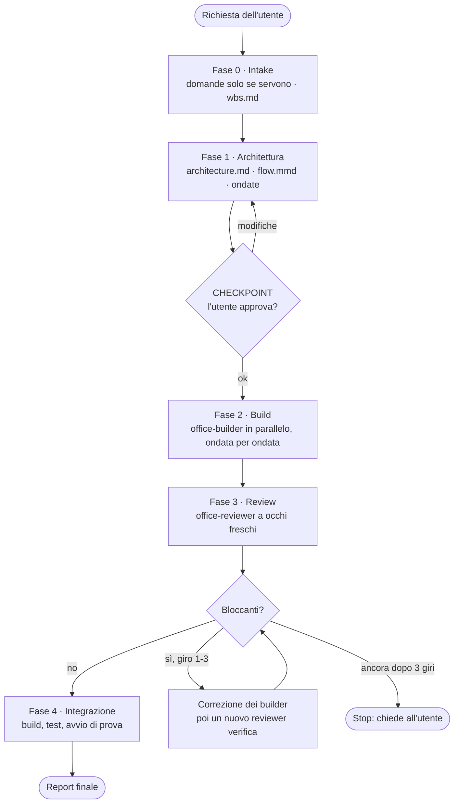

# Agent Office

**Una skill per [Claude Code](https://code.claude.com) che porta un software dall'idea al codice funzionante, a fasi, con un solo stop per approvare l'architettura e una review fatta da chi non ha scritto il codice.**

Funziona con qualsiasi linguaggio e stack. Parla in italiano. Usa due soli subagent e nessuna dipendenza esterna.

```
/office creami un gestionale per il mio b&b con prenotazioni, calendario camere e fatture
```

---

## Indice

- [Perché usarla](#perché-usarla)
- [Come si attiva](#come-si-attiva)
- [Come si usa](#come-si-usa)
- [Il flusso](#il-flusso)
- [I due agenti](#i-due-agenti)
- [Lo stato condiviso: `.agent-office/`](#lo-stato-condiviso-agent-office)
- [Ricerca online](#ricerca-online)
- [Installazione](#installazione)
- [Struttura del repository](#struttura-del-repository)
- [Test effettuati](#test-effettuati)
- [Limiti noti](#limiti-noti)
- [Personalizzare](#personalizzare)
- [Licenza](#licenza)

---

## Perché usarla

Chiedere a un assistente «creami un'app» di solito produce subito del codice, costruito su ipotesi che nessuno ha approvato. Agent Office cambia l'ordine delle cose:

| Senza la skill | Con Agent Office |
|---|---|
| Scrive codice subito, su ipotesi implicite | Prima un piano: WBS, architettura e flowchart, che approvi tu |
| Le scelte prese da solo restano nascoste | Ogni assunzione è scritta in `decisions.md` e la vedi al checkpoint |
| Chi scrive il codice lo controlla anche | La review la fa un agente che **non** ha scritto il codice |
| Correzioni senza fine o nessuna correzione | Loop di correzione limitato a **3 giri**, poi chiede a te |
| Il contesto si perde se la sessione si interrompe | Tutto lo stato sta in file: si riprende da dove si era rimasti |
| Domande continue, o nessuna | Chiede solo per le «cose grosse», sempre con una proposta |

In pratica:

- **Un solo stop obbligatorio.** Le domande che possono aspettare finiscono nel checkpoint dell'architettura, insieme al piano. Di solito rispondi una volta sola.
- **Lavoro in parallelo senza conflitti.** I task della WBS sono divisi in «ondate»: due task che toccano lo stesso file non lavorano mai in contemporanea.
- **Resta magra.** Due agenti, niente hook, niente telemetria, niente dipendenze. L'estetica è una lente della review, la correzione è il loop della review: nessun agente in più.
- **Agnostica.** Python, TypeScript, Go, una CLI, un sito, un'API, un bot: il processo è lo stesso.

## Come si attiva

| Modo | Esempio | Note |
|---|---|---|
| **Comando `/office`** | `/office sviluppa una API REST in Go per il magazzino` | Il modo più affidabile: parte sempre |
| **Comando `/agent-office`** | `/agent-office ...` | Il nome della skill. Funziona anche se hai installato solo la skill |
| **Linguaggio naturale** | «creami un'app…», «costruiamo un progetto…», «sviluppa X», «mettiamo in piedi un MVP» | Dipende da Claude: vedi sotto |
| **`/office` senza testo** | `/office` | Se nella cartella esiste `.agent-office/`, riprende il lavoro in corso |

**Non si attiva**, di proposito, per fix puntuali, singole funzioni, script brevi o domande sul codice: lì il processo a fasi costerebbe più di quanto rende.

**Attivazione automatica più affidabile.** Nei test, con una richiesta in linguaggio naturale Claude tende a mettersi subito al lavoro invece di consultare la skill. Se vuoi che parta da sola, aggiungi questa riga al tuo `~/.claude/CLAUDE.md`:

```bash
grep -q "skill agent-office" ~/.claude/CLAUDE.md 2>/dev/null || printf '\nQuando ti chiedo di creare o sviluppare un'"'"'app, un sito, un bot, un'"'"'API o un progetto con più funzionalità, usa la skill agent-office.\n' >> ~/.claude/CLAUDE.md
```

## Come si usa

1. **Chiedi quello che vuoi costruire**, anche in una riga: `/office app per la palestra che calcola il mio livello fisico`.
2. **Rispondi alle eventuali domande.** Arrivano solo se la richiesta è davvero ambigua (per esempio: app web o nativa?), tutte in un messaggio, ognuna con una proposta. Puoi rispondere «ok alle proposte».
3. **Approva il piano al checkpoint.** Ricevi il flowchart Mermaid, stack e componenti, le ondate di lavoro, le assunzioni fatte e le **migliorie proposte** (numerate, facoltative). Rispondi:
   - `ok`: procede con il piano base;
   - `ok + 1, 3`: procede includendo le migliorie 1 e 3;
   - oppure scrivi cosa cambiare: le modifiche piccole le applica e parte, quelle grosse le ripresenta.
4. **Lascia lavorare.** Da qui in avanti va da sola fino alla fine: build in parallelo, review, correzioni, integrazione e test.
5. **Leggi il report finale**: cosa è fatto, come si avvia, esito di build e test, cosa è rimasto aperto.

**Quando si ferma a chiederti qualcosa dopo l'ok:**

- scelta di stack o framework non ovvia;
- operazioni distruttive o irreversibili;
- dipendenze esterne a pagamento;
- decisioni con impatto sulla sicurezza;
- una correzione che cambierebbe molto l'architettura che hai approvato;
- la review che non converge dopo 3 giri.

Tutto il resto lo decide da sola e lo annota in `decisions.md`.

**Riprendere un lavoro interrotto:** riapri Claude Code nella cartella del progetto e lancia `/office`. La skill legge `.agent-office/progress.md` e riparte dalla fase giusta.

## Il flusso



| Fase | Chi | Cosa produce |
|---|---|---|
| 0 · Intake | orchestratore (thread principale) | `wbs.md`, assunzioni in `decisions.md` |
| 1 · Architettura | orchestratore | `architecture.md`, `flow.mmd`, WBS con dipendenze e ondate, **checkpoint** |
| 2 · Build | `office-builder` (paralleli dove possibile) | il codice, `progress.md` aggiornato |
| 3 · Review | `office-reviewer` (sempre un'istanza nuova) | finding numerati in `progress.md`, max 3 giri di correzione |
| 4 · Integrazione | orchestratore | build e test finali, report |

I finding della review sono di due tipi:

- **bloccante**: non compila, test falliti, crash, comportamento diverso da architettura o WBS, rischio di sicurezza;
- **minore**: tutto il resto, compresi stile e usabilità.

Solo i bloccanti tengono aperto il loop. Così converge: un reviewer nuovo a ogni giro troverebbe sempre qualche dettaglio di stile.

## I due agenti

| Agente | Tool | Ruolo |
|---|---|---|
| `office-builder` | Read, Write, Edit, Bash, Grep, Glob | Implementa una foglia della WBS, o corregge finding indicati per ID. Legge sempre `wbs.md` e `architecture.md` prima di agire, tocca solo i file del suo task, aggiorna solo la propria riga di `progress.md`. Se incontra una «cosa grossa» si ferma e segna il task `bloccato`. |
| `office-reviewer` | Read, Grep, Glob, Bash | Verifica il codice contro l'architettura con cinque lenti: correttezza, conformità, integrazione, sicurezza, estetica. Esegue build e test. Non scrive codice di feature: solo il report, più fix minimi di una riga se l'orchestratore glielo chiede. |

Entrambi partono «freddi», senza vedere la conversazione: ricevono solo un ID («Task WBS 2.1», «Correggi R3, R5») e trovano tutto il resto nei file. Per questo i documenti in `.agent-office/` sono l'unica fonte di verità.

## Lo stato condiviso: `.agent-office/`

La skill crea questa cartella nella radice del progetto, partendo dai template in `skills/agent-office/templates/`.

| File | Contenuto |
|---|---|
| `wbs.md` | Work Breakdown Structure: albero dei task con ID, dipendenze, file di output, criterio «fatto quando» e ondate di build |
| `architecture.md` | Perimetro, stack, componenti, cartelle, dati, **contratti tra moduli**, sicurezza, comandi di verifica, migliorie proposte |
| `flow.mmd` | Diagramma di flusso in Mermaid |
| `decisions.md` | Log delle decisioni (chi ha deciso cosa e perché) e domande aperte |
| `progress.md` | Fase corrente, stato di ogni task, sezioni di review con i finding |
| `ricerca.md` | Solo se è stata fatta una ricerca online: sintesi e fonti |

Conviene tenerla nel repository del progetto: documenta come e perché il software è fatto così.

## Ricerca online

Se il progetto dipende da informazioni esterne da verificare (API, librerie e versioni, valori di riferimento, normative), la skill chiede **una volta sola** il permesso di usare in autonomia la skill `deep-research`, dicendo cosa cercherebbe. La domanda arriva insieme alle altre, senza stop in più.

- **Sì**: lancia le ricerche da sola quando servono e salva sintesi e fonti in `.agent-office/ricerca.md`, che builder e reviewer leggono.
- **No**: procede con ciò che sa e annota le assunzioni.
- Se `deep-research` non è installata, chiede lo stesso permesso per una ricerca web normale.

## Installazione

Requisiti: [Claude Code](https://code.claude.com) con i subagent. Nient'altro.

**Per tutti i tuoi progetti** (consigliato):

```bash
git clone https://github.com/arkalinux0/agent-office.git
```

```bash
mkdir -p ~/.claude && cp -r agent-office/skills agent-office/agents agent-office/commands ~/.claude/
```

Poi apri una nuova sessione di Claude Code e prova `/office`.

**Solo per un progetto**: copia le stesse tre cartelle in `.claude/` dentro il progetto.

**Solo la skill**: se copi soltanto `skills/agent-office/`, al primo uso la skill installa da sola i due agenti in `~/.claude/agents/`. In quella prima sessione usa al loro posto un subagent generico con le stesse istruzioni. Il comando disponibile è `/agent-office`; per avere `/office` serve anche `commands/office.md`.

**Aggiornare**: `git pull` nella cartella clonata e ripeti la copia.

## Struttura del repository

```
agent-office/
├── README.md
├── LICENSE
├── skills/agent-office/
│   ├── SKILL.md            ← l'orchestratore: regole e fasi
│   ├── templates/          ← copiati in .agent-office/ a ogni progetto
│   │   ├── wbs.md
│   │   ├── architecture.md
│   │   ├── flow.mmd
│   │   ├── decisions.md
│   │   └── progress.md
│   ├── agents/             ← copia degli agenti, per l'auto-installazione
│   └── evals/              ← casi di test (formato `claude plugin eval`)
├── agents/
│   ├── office-builder.md
│   └── office-reviewer.md
└── commands/
    └── office.md           ← il comando /office
```

## Test effettuati

Con [skill-creator](https://github.com/anthropics/skills) sono state confrontate esecuzioni con e senza skill, fermandosi al checkpoint.

| Richiesta | Con skill | Senza skill |
|---|---|---|
| «creai app per la palestras che conta il mio livello fisico» | **5/5**: due sole domande, ognuna con una proposta, nessun codice prima dell'ok | 1/5: app scritta subito, con valori di riferimento inventati |
| Stessa richiesta, con permesso alla ricerca online | **7/7**: permesso chiesto insieme alle altre domande, ricerca autonoma, fonti in `ricerca.md` richiamate dall'architettura | 3/7: ha cercato, ma ha scritto subito il codice senza piano né fonti salvate |
| «crea uno script python con lo spoco di avere un cambio di denaro» | La skill non si attiva, di proposito: è uno script breve | — |

**Attivazione in linguaggio naturale**, su 20 richieste realistiche:

- non si è mai attivata per errore sui 10 casi simili da escludere (bug, funzioni singole, script, review, business plan);
- si è attivata raramente sulle richieste giuste: tre description diverse hanno dato lo stesso risultato.

Da qui il consiglio di usare `/office` o la riga in `CLAUDE.md`.

I casi di test sono in `skills/agent-office/evals/`. Con Claude Code puoi rilanciarli, ma sono esecuzioni reali, a pagamento:

```bash
cd skills/agent-office && claude plugin eval . --allow-tools Write,Edit,Bash
```

## Limiti noti

- **Pensata per Claude Code.** Ha bisogno dei subagent e del filesystem del progetto. Su claude.ai non funziona come previsto.
- **L'attivazione automatica è debole**: vedi [Come si attiva](#come-si-attiva).
- **Costa più di una risposta diretta.** Pianificazione, review e documenti richiedono più token e tempo. Il guadagno sta nel piano approvato, nella review indipendente e nella tracciabilità, non nella velocità.
- **I «fix minimi» del reviewer passano da Bash**, perché il reviewer non ha `Edit`. È una scelta voluta, per tenere i fix davvero minimi.
- **`deep-research`** non è inclusa: se non è installata, la skill ripiega sulla ricerca web.

## Personalizzare

- **Lingua, tono, fasi**: modifica `skills/agent-office/SKILL.md`, sono circa 80 righe.
- **Formato dei documenti**: modifica i template in `skills/agent-office/templates/`.
- **Tool o modello degli agenti**: modifica il frontmatter in `agents/*.md`, ricordando di tenere allineata la copia in `skills/agent-office/agents/`. Senza `model` usano lo stesso modello della conversazione.
- **Numero massimo di giri di review o di builder in parallelo**: sono scritti in `SKILL.md` (Fase 2 e Fase 3).

## Licenza

[MIT](LICENSE): usala, modificala e condividila liberamente.
